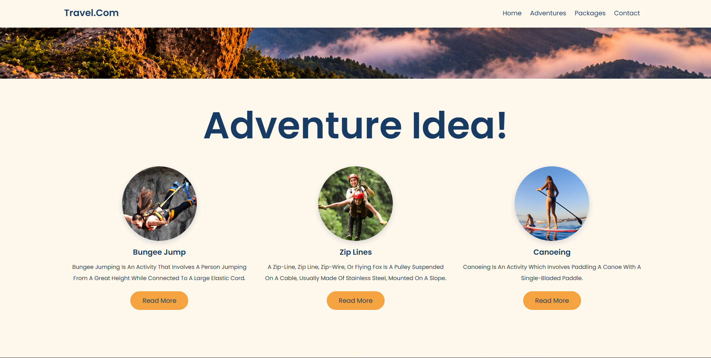
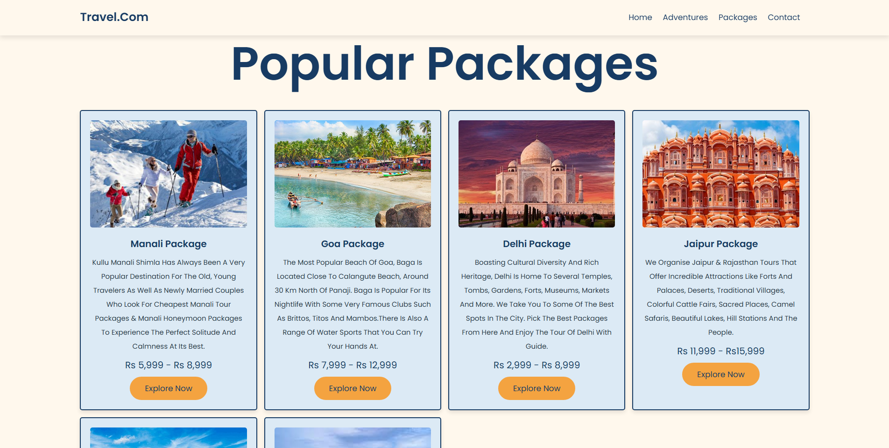

# 🌍 Simple Travel Website  

## ✈️ Overview  
This is a simple, responsive travel website built using HTML, CSS, and JavaScript. It features an attractive UI, engaging animations, and an interactive user experience to showcase travel destinations and services.  

## 📸 Application Screenshots

<table>
  <tr>
    <td align="center">
      
    </td>
    <td align="center">
      
    </td>
  </tr>
  <tr>
    <td align="center">
      
    </td>
    <td align="center">
      
    </td>
  </tr>
</table>


## 🎨 Features  
✅ Fully responsive design  
✅ Modern UI with smooth animations  
✅ Interactive navigation bar  
✅ Image sliders and destination highlights  
✅ Contact form for user inquiries  

## 🛠️ Technologies Used  
- **HTML** – Structure of the website  
- **CSS** – Styling and responsiveness  
- **JavaScript** – Dynamic interactions  

## 🚀 Installation & Usage  
1. Clone this repository:  
   ```bash
   git clone https://github.com/Chatur07/Simple_Travel_Website.git
   ```
2. Navigate to the project folder:  
   ```bash
   cd Simple_Travel_Website
   ```
3. Open `index.html` in your browser.  
 

## 🤝 Contributions  
Contributions are welcome! Feel free to fork this repository and submit a pull request.  

## Show support   
   ⭐ Star the repository 
   🤝 **Follow on [GitHub](https://github.com/Chatur07)** and [LinkedIn](www.linkedin.com/in/vikhyat-chaturvedi-678308252)
  

---
